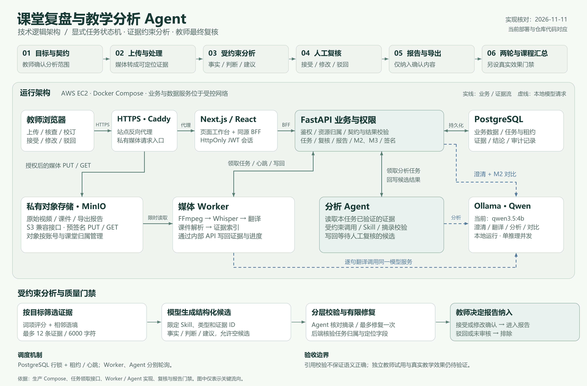

# 技术逻辑架构

核对日期：2026-11-11。图中展示当前生产部署对应的运行方式，详细产品范围以[产品与技术手册](product-and-technology-handbook.md)为准。

[下载可编辑 SVG](assets/classroom-agent-architecture.svg) · [打开高清 PNG](assets/classroom-agent-architecture.png)

## 从页面到可复核报告

教师先确认分析目标与契约，再上传课堂视频和课件。契约记录本次允许分析的范围、关注点和判断标准。浏览器经 Caddy 的 HTTPS 入口访问 Next.js 页面；Next.js 的 BFF（服务于页面的后端代理）读取 HttpOnly 会话 Cookie，并调用 FastAPI。FastAPI 负责鉴权、资源归属、任务状态、复核和报告等业务，PostgreSQL 保存相关记录。

视频、课件与导出文件存入私有 MinIO。业务 API 签发限时预签名链接，浏览器据此上传或下载媒体；文件本体不经过 BFF 的 JSON 转发。Worker 通过内部 API 领取任务，执行 FFmpeg 音频提取、Whisper 转写、翻译、课件解析和证据索引，并写回可定位的逐字稿与页码证据。

Agent 只读取当前任务授权范围内的证据。它按目标进行词项评分，补充相邻逐字稿语境，将模型输入限制为最多 12 条证据、6000 字符。该步骤是有限的词项检索，没有部署向量数据库。模型通过受约束 JSON 生成事实、判断与建议，并附带本次提供的证据 ID 和逐字摘录。允许模型返回空候选；空结果会作为证据不足处理，不会强制补齐结论。

Agent 检查结构、Skill、证据范围和摘录是否来自所提供的连续原文。结构或摘录检查失败最多重生成一次，仍无效则停止。FastAPI 写入边界另行检查服务身份、任务状态与阶段、Trace 一致性、证据所属任务及定位字段；逐字摘录的一致性校验位于 Agent 编排层。逐字匹配不等于语义支持，因此候选必须再由教师接受、修改确认或驳回。

报告只组合已接受或修改确认的内容。Markdown、HTML 和 PDF 由服务端渲染器确定性生成，保留原文引用、时间或页码、模型及提示词版本等来源信息。未审核与已驳回结论被排除；模型不会直接绕过复核生成最终交付报告。

## 两轮改进与课程总览

M2 将已确认建议转为教学行动和可观察的成功标准，关联同课程第二轮课堂。在当前实现中，两轮证据对比由 FastAPI 接口调用专用对比 Agent，再由教师核查来源与判断、保存复核说明。它不通过 M1 分析任务的后台轮询链路执行。

M3 展示课程、课堂与符合条件的改进循环。真实教学效果另有门禁，包括真实资料、独立第二次授课与行动执行声明、已执行的行动，以及来源有效且经复核的改善判断。2026-11-11 的合成演示验证了处理和人工把关机制，没有作为真实教学改善或独立教师试用证据。

## 调度、模型与存储边界

Worker 与 Agent 是独立进程，通过内部服务令牌访问 FastAPI，分别领取任务并发送心跳。PostgreSQL 行锁与租约控制任务领取和过期回收；当前没有 Redis/Celery 队列。任务执行状态可恢复，不代表所有外部故障都已完成生产验证。

当前 AWS 单机运行 Docker Compose 服务。Caddy 提供站点及私有对象存储的 HTTPS 入口，数据库和模型服务不直接向公网开放。Ollama 提供 `qwen3.5:4b` 本地推理，用于目标澄清、翻译、候选分析和两轮对比，生产配置为单推理并发。Whisper 单独承担语音识别，不能与 Qwen 的文本推理混为一层。

## 代码核对入口

| 图中职责 | 实现位置 |
|---|---|
| 生产容器与网络 | [生产 Compose](../deploy/compose.production.yml)、[AWS Compose](../deploy/compose.aws.yml)、[Caddy](../deploy/Caddyfile.aws) |
| BFF 与会话 | [页面后端代理](../frontend/src/lib/server/backend.ts) |
| 任务领取与租约 | [内部任务 API](../backend/app/api/tasks.py)、[任务仓库](../backend/app/repositories/tasks.py) |
| 媒体处理 | [Worker 运行器](../worker/runner.py)、[处理流水线](../worker/pipeline.py) |
| 有限证据检索 | [词项评分与相邻语境](../agent/tools/select_analysis_evidence.py) |
| 模型约束与摘录校验 | [Agent 编排器](../agent/orchestrator.py)、[Agent 运行器](../agent/runner.py) |
| 写入权限与证据归属 | [分析 API](../backend/app/api/analyses.py)、[结果仓库](../backend/app/repositories/results.py) |
| 复核与报告 | [复核仓库](../backend/app/repositories/reviews.py)、[报告组合器](../agent/reporting/composer.py)、[导出渲染器](../backend/app/services/report_exports.py) |
| M2 对比与门禁 | [改进循环 API](../backend/app/api/improvements.py)、[证据对比 Agent](../agent/skills/evidence_comparison.py) |

图中箭头仅表示关键请求和证据流，省略了返回值、运维备份及次要接口；不作为完整网络或灾难恢复拓扑。
